# 视障寻物助手从零开发手册

六位同学先修改各自标注的章节，统一确认后，再将整份手册交给 Codex 从空项目开始开发。下面的文件路径均为未来需要创建的文件，不是现有文件。

## 一 产品与系统概览

### 产品目的与范围

制作手机网页，帮助视障用户在桌面找到指定物品、了解物品相对自己的位置、按语音移动手部，并核验是否拿到了正确物品。流程是：说出目标→手持扫描→提示调整手机→发现候选物品→固定手机→校准本人方向→位置说明与单步手部指导→拿取核验。

首版限定单人、单桌面、同一只操作手和安全日常物品，允许同伴帮助固定手机。调用现有视觉大模型，以提示词改善非视觉表达；不开发独立检测算法，不默认微调，不做室外导航、精确测距、账号、数据库或原生 App。首版默认模拟模式，真实模式须配置服务并取得上传同意。

### 六个模块

| 编号 | 模块 | 负责的系统能力 |
|---|---|---|
| 1 | 架构与流程 | 公共数据、接口、状态与取消规则 |
| 2 | 模型接入 | 统一网关、模拟及云端或本地适配器 |
| 3 | 提示词 | 非视觉表达、阶段指令与输出格式 |
| 4 | 网页 | 输入、按钮、状态与无障碍操作 |
| 5 | 摄像头与语音 | 拍摄、录音、转写、播报及权限 |
| 6 | 测试评估 | 自动化、实际试用、提示词对照 |

### 模块关系与接口

前端使用 React、TypeScript、Vite，后端使用 FastAPI、Pydantic、httpx，通过 HTTP JSON 通信。网页调用统一分析接口，不直接连接模型厂商；更换模型只调整后端配置或新增适配器。后端不保存任务，前端流程模块是唯一状态管理者。

```mermaid
flowchart LR
  A[1 架构与流程] --> B[4 网页]
  C[5 摄像头与语音] --> A
  A -->|分析请求| D[2 模型网关与适配器]
  E[3 提示词] --> D
  D -->|统一结果| A
  A -->|播报指令| C
  F[6 测试评估] -.验证.-> A
  F -.对照.-> D
```



三个接口：`GET /api/health` 返回能力配置；`POST /api/analyze` 接收目标、阶段和图片，返回位置、一步动作及拿取证据；`POST /api/transcribe` 将录音转成待确认文本。共享字段、设备方法和状态规则在模块1、5中定义，不另依赖外部设计文档。

## 二 模块开发任务

各章开头的编号仅表示谁主要修改这一章的开发要求，可替换为姓名；不要求六个人分别写六套代码。下面的执行编号用于 Codex 逐项实现和检查，不是人员编号。

### 1 架构与流程

**文档修改：1号同学。主要修改项目结构、公共接口、状态和取消规则。**

#### 1.1 创建项目结构

正式开发时，在用户指定的空目录创建下列结构。若目录中已有其他项目，先询问，不清空或覆盖。此处是目标目录说明，不要求现在生成代码。

```text
web/
  src/App.tsx
  src/useAssistant.ts
  src/styles.css
  src/lib/contracts.ts
  src/lib/api.ts
  src/lib/media.ts
  src/lib/workflow.ts
backend/
  __init__.py
  main.py
  schemas.py
  config.py
  gateway.py
  safety.py
  asr.py
  providers/base.py
  providers/mock.py
  providers/compatible.py
  tests/
prompts/
  common.md
  accessible.md
  baseline.md
evaluation/
  cases.jsonl
  run_compare.py
.env.example
.gitignore
requirements.txt
```

前端用 Vite 的 React TypeScript 模板创建必要配置和入口；后端建立 Python 虚拟环境。后端依赖限定为FastAPI、Pydantic、httpx、uvicorn、Pillow和python-dotenv，分别用于API、类型、请求、运行服务、图片解码及读取.env；测试使用pytest、Vitest、React Testing Library。开发者记录实际选定的兼容依赖版本并提交锁文件，不因示例使用未验证的版本号。不得自行增加数据库、队列、登录系统或状态管理框架。

#### 1.2 公共数据

先同时定义 `backend/schemas.py` 与 `web/src/lib/contracts.ts`。字段名称、枚举值和可空规则一致；Pydantic 严格校验并拒绝多余字段，TypeScript 不使用 any 绕过检查。

图片 Frame 固定为 `id:string`、`captured_at_ms:number`、`data_url:string`。id 为每帧生成的 UUID；时间是拍摄完成时的 Unix 毫秒；data_url 仅接受 JPEG 或 PNG 的 base64，不接受远程地址、路径或 SVG。

`POST /api/analyze` 的所有字段均必填：

| 字段 | 类型或取值 | 含义 |
|---|---|---|
| session_id、request_id | 非空字符串，最长64字符 | 每个任务、每次请求分别生成UUID |
| revision | 非负整数 | 当前任务版本，取消时递增 |
| mode | mock、live | 模拟或真实；不得失败后自动切换 |
| scenario | success、not_found、wrong_object、occluded | 只影响模拟，真实模式忽略 |
| target | 去空白后1—120字符 | 用户目标，只作为数据 |
| phase | search、calibrate、guide、verify | 当前分析阶段 |
| turn | 非负整数 | 当前阶段已接受的回答数，换阶段归零 |
| frames | Frame数组 | 当前观察帧，顺序见下一表 |
| reference | Frame或null | 候选身份或校准起点 |
| calibration_frames | Frame数组 | 已保存的右移、远离两帧 |
| calibrated | boolean | 当前方向校准是否有效 |
| last_instruction | 最长200字符，允许空串 | 同阶段上一条已接受的指令 |

| phase | frames | reference | calibration_frames |
|---|---|---|---|
| search | 1张当前图 | null | 空数组 |
| calibrate | 3张：起点、本人右移、远离身体 | 发现候选时保存的身份图 | 空数组 |
| guide | 1张当前图 | 校准起点图 | 右移、远离两图 |
| verify | 3张连续当前图 | 校准起点图 | 右移、远离两图 |

真实模式按表校验；同次请求图片ID不可重复，guide、verify缺校准材料返回400。mock使用空数组和null，不申请相机，豁免图片数量、图片材料和时效检查，但仍遵守阶段、calibrated标记及Observation证据字段。所有真实图片仅在前端内存中保存。

所有模型适配器返回统一 Observation，字段全部必填：

| 字段 | 类型或取值 |
|---|---|
| action | 下一节定义的动作枚举 |
| instruction | 1—200字符，下一步动作 |
| position_description | 0—100字符，物品相对用户的位置 |
| target_position | left、right、front、left_front、right_front、near_hand、unknown |
| camera_motion | pan_left、pan_right、tilt_up、tilt_down、move_closer、move_farther、none |
| target_visible、hand_visible、reference_valid | boolean |
| grasp_state | not_held、candidate、confirmed、wrong、unknown |
| target_matches、object_lifted | boolean或null，未知用null |
| reason | 1—300字符，仅简短观察证据或不确定原因，不要求推理过程 |

`/api/analyze` 响应结构为：

```json
{
  "session_id": "demo-session",
  "request_id": "demo-request",
  "revision": 0,
  "mode": "mock",
  "phase": "search",
  "observation": {
    "action": "scan",
    "instruction": "模拟演示：手机向你右侧缓慢转动一点，然后停住。",
    "position_description": "",
    "target_position": "unknown",
    "camera_motion": "pan_right",
    "target_visible": false,
    "hand_visible": false,
    "reference_valid": true,
    "grasp_state": "not_held",
    "target_matches": null,
    "object_lifted": null,
    "reason": "预设结果，不代表真实识别"
  },
  "reason_code": "ok",
  "provider_id": "mock",
  "model_id": "mock",
  "prompt_id": "accessible-001",
  "latency_ms": 0
}
```

以上为模拟搜索响应示例；实际ID与revision原样回显请求，其他元数据由后端填写，不由模型生成。只允许经过后端检查的observation进入前端流程。

错误统一为 `{"code":"错误码","detail":"可显示的简短中文说明"}`。400表示图片组合或时间不合法；401表示访问口令不符；413表示媒体超限；422表示字段、类型或枚举错误；429表示超出并发；502表示上游失败或输出不合法；503表示未配置或不支持多图；504表示上游超时。错误详情不得含图片、音频、密钥或厂商原始回答。

#### 1.3 动作与状态

页面阶段只有 idle、search、position、calibration、guide、verify、success。另设 paused、busy、error、awaiting_step_confirmation，不为每种错误创建新阶段。页面的 calibration 对应接口的 calibrate。

| action | 允许phase | 前端处理 |
|---|---|---|
| scan | search | 按camera_motion提示移动手机，观察下一帧 |
| position | search | 保存候选身份图，停止自动分析，要求固定手机 |
| calibrated | calibrate | 保存起点及方向图，进入guide |
| move_left、move_right | guide | 手向本人左或右移动一点并停住 |
| move_away、move_toward | guide | 手远离或靠近身体一点并停住 |
| grasp | guide | 提示尝试拿起，随后进入verify，不判成功 |
| show_object | verify | 提示将手中物品略抬起并停住，再观察 |
| confirmed | verify | 证据检查通过才进入success |
| wrong_object | verify | 暂停，提示可能拿错，由观察员协助后重置 |
| hold、uncertain | 所有phase | 暂停自动分析，说明原因 |

只有 scan 可以使用非none的 camera_motion。左右以本人为参照；near_hand只是靠近操作手，不代表可直接抓取。search、calibrate 的目标位置必须unknown且位置文本为空；搜索允许提示“手机向你右侧缓慢转动”，不允许未经校准断言目标在本人右侧。

正常循环：采新帧→发一个请求→校验ID、任务版本与时效→更新状态→播报位置和一个动作→等播报结束与间隔→重新采帧。不要按固定定时器持续发送请求，也不要累积旧帧。

关闭自动播报时，显示同一指令并等待“已停住，继续观察”。等待不是暂停，不清校准；点击后scan、move、show_object继续本阶段，grasp进入verify。任何“重播”都不推进流程，不启动第二条循环。

#### 1.4 固定手机与方向校准

1. 收到position后提示固定手机，允许同伴协助；此时不得给取物动作。
2. 用户点击“手机已固定”，进入三步校准；镜头需要覆盖目标和手的活动区域。
3. 让操作手张开放在靠近身体的桌面位置，用户点击采“起点”。
4. 让这只手向本人右侧移动一点并停住，点击采“右移”。
5. 让手先回起点，再向远离身体的方向移动一点并停住，点击采“远离”。
6. 将身份图和三张校准图按角色发给模型。只有模型返回calibrated且手、目标可见、参照有效时才通过；否则清本次三图，暂停，重新校准。
7. 通过后，用起点图作reference，保存其余两图；下一轮guide必须采当前图，不假定手仍在起点。
8. 手机、座位或操作手改变时清校准。界面提供“手机移动了，重新校准”，不自行开发姿态检测算法。

mock保留固定手机和三步校准按钮，但每次点击只推进模拟步骤，不调用摄像头；三步完成后发送空图片的calibrate请求，收到模拟calibrated后设置校准标志。页面和播报持续说明这是模拟。

#### 1.5 固定参数与停止

| 项目 | 固定值或规则 |
|---|---|
| 图片 | 最长边960px，JPEG质量0.75；每张解码后≤1MiB；最多6张 |
| HTTP请求体 | ≤9MiB；解码图片≤1600万像素；拒绝伪装、损坏图片 |
| 录音 | ≤10秒、≤3MiB；类型由模块5规定 |
| 超时 | 上游25秒，浏览器28秒，单条播报30秒 |
| 并发 | 单页面分析与转写互斥；服务端共享最多2个上游请求，超出返回429 |
| 自动观察间隔 | 播报完成后live等1800ms，mock等750ms，再采新帧 |
| 连续运行 | search、guide、verify每阶段自动运行最多60秒；固定手机、手动确认等待不计 |
| 当前帧时效 | search 30秒、calibrate 60秒、guide及verify 6秒；取本轮最早当前帧 |
| 核验采样 | 3帧，前一帧完成后至少等300ms再拍下一帧 |
| 模型参数 | temperature=0.1，max_tokens=700，stream=false；不支持就报错 |
| 上游输出 | 响应体≤64KiB、模型文本≤16384字符；超限报502 |

后端收到请求和前端接受结果、播报前都检查时效；未来时间超前5秒以上返回400。历史参照不套用当前帧时限，但只能来自本次有效校准。真实模型经常超过6秒时记录限制，不通过放宽时效制造演示成功。

暂停、重置、改目标或模式、切后台、撤回上传同意、手机移动时：revision加1，取消请求和计时，停止播报，清校准。迟到的录音、图片、网络和播报回调都必须检查任务ID与revision，不得恢复流程或设备。相机与录音轨道在暂停、后台、完成、离开时释放。

暂停、后台、手机移动可保留候选身份图；恢复时有候选则回position重新校准，无候选则回search。重置、换目标或模式、撤回图片同意还要清身份图。换目标或模式建立新session；重置回idle并清本次事件。暂停必须手动恢复，不能因页面重新可见就继续。

#### 1.6 后端检查

按顺序检查：请求结构→当前帧时效→输出结构→动作阶段→校准有效性→手与目标可见性→表达→拿取证据。结构错误走HTTP错误；结构有效但不适合动作时返回200，把动作改成hold或uncertain，并给原因。

guide的move、grasp要求手和目标可见、有效校准、target_position非unknown且位置文本非空。verify的confirmed要求参照有效、手和目标可见、grasp_state=confirmed、target_matches=true、object_lifted=true；live另要求3张合规当前帧，mock不要求真实图片，但不能免除这些状态与证据字段。wrong_object要求参照有效、手可见、grasp_state=wrong且target_matches=false；看不清不等于拿错。

被拦截时清位置文本，位置改unknown、camera_motion改none、grasp_state改unknown，两个证据布尔值改null。instruction改为“请先停手，我暂时无法确认，请暂停或重新校准。”reason_code从missing_calibration、reference_invalid、stale_frame、unsupported_action、unsafe_expression、insufficient_evidence中选择。正常输出保留模型原文，不全部替换成模板。

表达检查仅做确定规则：禁用颜色参照词红色、黄色、蓝色、绿色、黑色、白色、紫色、橙色、灰色、棕色、粉色；禁用形状参照词圆形、方形、长条形；禁用画面左、画面右、屏幕左、屏幕右、左上角、右上角、左下角、右下角；禁用数字后紧接厘米、毫米、cm、mm的精确距离。move_left的指令含右或move_right含左也拦截。对instruction和position_description先做NFKC规范化再匹配；左右矛盾仅检查instruction。此词表不证明表达或方位正确，其他语义错误交真实评测，不增设第二次模型审核。

#### 1.7 执行清单与交付

- [ ] A01 创建空项目目录、基础入口和忽略规则；.env、缓存、录音和照片不得提交。
- [ ] A02 按1.2定义前后端类型，为合法、缺字段、错枚举、多余字段分别写测试。
- [ ] A03 建立三个API入口，先接返回固定结果的模型和设备替身。
- [ ] A04 在useAssistant中集中管理状态、ID、revision、定时器和上下文；页面不得另写一套流程。
- [ ] A05 实现扫描、固定、三步校准、引导、核验的转换及手动继续路径。
- [ ] A06 实现统一取消、恢复、过期拦截和后端证据检查；再接入真实设备与模型。
- [ ] A07 用假时钟及可控异步结果证明：取消后不再播报、返回旧结果不会改状态。

交付：可被网页调用的完整流程、公共类型、三个API和对应测试。此模块先确定合同，其他模块可用同一合同的替身并行开发。

### 2 模型接入

**文档修改：2号同学。主要修改模型网关、适配器、配置与模型调用。**

#### 2.1 网关和适配器边界

网关只做提示词装配、图片角色排列、调用适配器与统一输出校验；不播放声音，不修改页面阶段。适配器只处理厂商请求和响应格式，不决定流程。

内部接口固定为 `ModelGateway.analyze(request, prompt_variant) -> GatewayResult`，request使用模块1分析请求类型，prompt_variant仅允许accessible或baseline；产品API强制accessible，只有离线脚本使用baseline。`VisionProvider.analyze(prepared) -> Observation`接收system_prompt、task、images；task包含target、phase、turn、calibrated、last_instruction、scenario；images每项包含role与Frame。GatewayResult包含observation、provider_id、model_id、prompt_id、latency_ms。网关只校验输出结构，产品动作检查在API层完成。

图片顺序固定：reference→calibration_frames→frames。search当前图标current_1；calibrate的reference标identity_reference，三帧标calibration_origin、calibration_right、calibration_away；guide和verify的reference标calibration_origin，两方向图按同名角色标注，当前图标current_1至3。每张图片前放对应角色文字，不能丢失顺序或只发送最后一张。

首版仅两种适配器：mock及compatible。compatible连接已经运行的本地或云端、支持Chat Completions图像输入的服务；本项目不负责下载模型或启动推理服务器。不兼容这一协议的服务，以后通过新增适配器接入，不修改网页和Observation。

#### 2.2 环境配置

| 配置项 | 含义或默认值 |
|---|---|
| VISION_PROVIDER | 默认mock；真实模式使用compatible |
| VISION_BASE_URL | 服务端API根地址，去尾斜线后追加/chat/completions |
| VISION_API_KEY | 云端必需；仅localhost或127.0.0.1允许免密 |
| VISION_MODEL | 真实模型名称，由部署者填写，无默认厂商 |
| VISION_MAX_IMAGES | 部署者按模型文档设置；完整live流程要求≥6 |
| ASR_BASE_URL、ASR_API_KEY、ASR_MODEL | 独立转写服务，不复用视觉配置 |
| APP_ACCESS_TOKEN | 非本机访问必填；浏览器仅保存在内存 |

`.env.example`只放变量名、说明和空值。后端启动时读取配置；更换模型后重启。不在网页接受任意模型网址，不自动降级、换模型或更换参数。

`GET /api/health` 返回status="ok"、live_available、asr_available、provider_id、model_id、max_images、prompt_id。标识未配置时为空。live_available只表示compatible配置、鉴权和≥6图能力齐全；asr_available表示独立ASR配置齐全；不联网探测，不表示效果通过。

#### 2.3 一次真实调用

1. 创建共享httpx异步客户端；应用结束时关闭，不为每帧新建连接池。
2. 依据mode选择mock或compatible；live未配置返回503，不回退模拟。
3. 用模块3模板形成system消息；将目标等作为单独JSON任务数据放入user消息。
4. 将每个角色文字和对应image_url项按顺序加入同一user消息；不上传文件到第三方存储换URL。
5. 请求配置地址，设置模型与固定生成参数；API key仅放认证头。
6. 只接受首个选择项的message.content为字符串。允许剥除一层完整json代码围栏，其余必须直接解析成JSON对象；不从散文猜字段，不再调用模型修复。
7. 严格校验Observation，交架构检查层；记录耗时和错误码，不记录原始图片、音频、请求体或完整回答。
8. 关闭自动HTTP重试和重定向；网络错误、HTTP失败、超时、非法JSON分别按1.2返回，错误文本脱敏。

#### 2.4 模拟规则

| scenario | search | calibrate | guide | verify |
|---|---|---|---|---|
| success | turn0为scan向右转手机，之后position | calibrated | turn0右移，turn1远离，之后grasp | turn0 show_object，之后confirmed |
| not_found | 一直scan，左右交替 | uncertain | uncertain | uncertain |
| wrong_object | 同success | 同success | 同success | wrong_object |
| occluded | 同success | 同success | hold，手不可见 | uncertain |

每个结果填齐Observation。默认可见性与参照有效为true，位置unknown、位置文本空、camera_motion=none、grasp_state=not_held、证据字段null；再按动作覆盖。scan填手机方向；move与grasp填right_front及“模拟目标在你右前方”；grasp、show_object填candidate；confirmed填confirmed且两证据true；wrong_object填wrong、target_matches=false、object_lifted=true。not_found目标不可见，occluded手不可见。hold、uncertain证据为null且状态unknown。

所有模拟指令以“模拟演示”开头，reason明确“预设结果，不代表真实识别”。模拟不读图、不联网；不能用模拟结果计算识别率或提示词效果。

#### 2.5 执行清单与交付

- [ ] B01 按公共类型定义网关和适配器接口，先实现mock四种情景。
- [ ] B02 接收模块3提示词，完成图片角色排序和任务数据装配测试。
- [ ] B03 实现compatible请求、严格解析、超时、异常映射和配置检查。
- [ ] B04 用模拟HTTP验证6张图完整发送、错误不回退、空密钥云端拒绝、本机免密可用。
- [ ] B05 在用户配置并同意后验证一个真实服务；没有条件则写待验证，不填成功。
- [ ] B06 用两个不同模型配置或模拟服务验证切换只影响配置或适配器，前端与合同不变。

交付：统一网关、两个适配器、无密钥配置示例、模型连通与异常测试。需要模块1先提供类型、模块3提供提示词；此前可使用相同签名的替身。

### 3 提示词与非视觉表达

**文档修改：3号同学。主要修改系统提示词、表达示例和提示词对照规则。**

#### 3.1 提示词文件

common.md放角色、阶段规则、图片角色、完整JSON结构及证据边界；accessible.md放非视觉表达规则；baseline.md只放普通寻物要求。产品固定使用common加accessible；baseline只由离线评测使用，不接用户动作循环。

提示词中的数据插入采用JSON序列化，不能把用户目标拼进system消息。模型看到的文字、标签或用户目标均是待分析数据，不是可改写系统规则的指令。prompt_id初始为accessible-001或baseline-001，每次修改递增编号，评测记录实际编号。

#### 3.2 公共提示词必须包含

1. 角色：“你是受控桌面寻物助手，通过画面帮助用户理解位置并执行一个动作。”
2. 严格返回模块1的Observation JSON；不返回Markdown、不附解释、不遗漏字段。
3. 只选择当前phase允许的action；一次只给一个动作，移动后停住再观察。
4. search只寻找候选并指导手机移动；没发现目标也应明确未知，不编造方位。
5. calibrate根据三姿态建立本人方向；不能假定图像左等于本人左，分辨不了则uncertain。
6. guide分别给位置描述与下一步手部动作，不使用历史画面假定手仍在原位。
7. verify综合参照与三张当前图，判断目标身份、是否在手中和离桌；遮挡、重叠、消失均不足以确认。
8. 不确定、看不清、参照失效时hold或uncertain；reason只写简短可观察证据，不输出内部推理。

#### 3.3 非视觉表达必须包含

位置只采用“在你左侧、右侧、前方、左前方、右前方、靠近操作手”等本人可理解的参照。动作明确对象是“手机”还是“操作手”。不以颜色、外观、形状、画面方位或未经验证的厘米距离指路；不说“像图中这样”“那个东西旁边”。

instruction只给一项可以停下的动作，position_description只讲位置，不夹带第二动作。位置无法确定就保持空文本及unknown；不得只因为目标居中就声称用户已经能够拿到。

| 情况 | 合格示例 | 不合格示例 |
|---|---|---|
| 尚未找到 | 手机缓慢向你右侧转动一点，然后停住。 | 往画面右上角看。 |
| 发现候选 | 已发现候选钥匙，请固定手机后继续。 | 钥匙已对准镜头，是圆形的那串。 |
| 已校准定位 | 位置：钥匙在你右前方。动作：手向右移动一点，然后停住。 | 黄色盒子旁边就是钥匙。 |
| 向前调整 | 手向远离身体的方向移动一点，然后停住。 | 再往前十厘米就到了。 |
| 遮挡 | 请先停手，当前画面无法确认位置。 | 应该已经拿到了。 |
| 核验展示 | 将手中物品略抬起，然后停住。 | 拿起来转一圈再靠近镜头。 |

这些是表达要求和预期示例，不是假装已经跑过模型的结果。prompt是否有效必须用真实同输入对照评测证明。

#### 3.4 执行清单与交付

- [ ] C01 将common与两种表达模板分开，补齐全部字段、枚举和阶段允许动作。
- [ ] C02 写每个阶段至少一个正确示例和一个应拒绝或停手示例，检查无颜色、形状指路。
- [ ] C03 用模拟HTTP检查模板与任务数据分离、prompt_id可追踪、输出字段可解析；不把此项算模型效果。
- [ ] C04 使用模块6同一批授权素材，分别调用baseline与accessible；不更换模型或采样参数。
- [ ] C05 逐条标记问题是表达、方向、目标识别、相机取景还是时效；一次只改一个已观察到的问题类型并重跑。
- [ ] C06 提示词无改善时记录失败原因；本次不自动改成微调、检测算法或额外模型调用。

交付：三份提示词、编号规则、真实对照记录或待验证说明。需要模块1的合同、模块2的网关；文字草案和示例可以先完成。

### 4 网页与交互

**文档修改：4号同学。主要修改页面内容、按钮行为和无障碍体验。**

#### 4.1 单页结构

按顺序放置：应用名称与模式提示、目标输入及录音按钮、权限与上传同意、当前阶段和指令、主要操作、相机预览、折叠调试信息。不要增加登录、历史会话或多页导航。默认中文、手机竖屏、大按钮、深浅高对比；所有功能不能只靠图标和颜色区分。

模拟模式始终显示“模拟演示，未进行真实识别”；真实模式显示所用模型标识和已同意的上传类型。相机预览帮助观察员调试，不要求用户通过观看预览完成操作。

#### 4.2 按钮行为

| 控件 | 可用条件与行为 |
|---|---|
| 目标输入 | idle可编辑；运行中修改先暂停并确认重置 |
| 按住之外的点击录音 | 首次点击开始、再次点击停止，10秒自动停止；转写后填入输入框，不自动启动 |
| 开始寻找 | 已确认非空目标且未录音、无请求；live还需模型配置、支持相机能力及图片上传同意；点击后申请相机，等就绪再采首帧，拒绝则显示错误 |
| 暂停 | 请求、播报、录音期间始终可用，不能被busy屏蔽 |
| 继续 | paused时可用，按模块1恢复规则执行 |
| 手机已固定 | position时可用，进入三步校准 |
| 采起点／采右移／采远离 | calibration时按顺序启用；采集未结束不能重复点击 |
| 手机移动了 | 校准或引导期间可用，取消当前操作并回到position |
| 已停住，继续观察 | 关闭自动播报、当前等待确认时可用 |
| 重播 | 仅无请求且有未过期的当前指令时可用，不改阶段、不自动采帧 |
| 重新开始 | 清任务、设备与图片，回idle |

模式切换及目标修改先走统一取消。关自动播报时停止播报和下一轮计时：若当前已有动作待执行，进入手动确认；若尚未获得指令，不启动自动下一轮。重新打开播报不会重播或推进旧动作，先完成一次手动确认后按自动流程运行。

前台语音播报开启时，状态区使用aria-live="off"，避免与应用语音重复；关闭时改为polite。所有按钮有明确文本，键盘焦点可见；不强迫读屏焦点跟随每次模型回答跳转。success显示“系统判断已拿到，请观察员确认”，不把系统判断当人工成功。

#### 4.3 执行清单与交付

- [ ] D01 先接假状态和假回调完成单页，不请求模型。
- [ ] D02 实现目标确认、模拟/真实选择、四种模拟情景选择和独立上传同意。
- [ ] D03 将所有按钮绑定useAssistant提供的方法，页面组件不直接调用模型或循环拍摄。
- [ ] D04 实现固定手机与三步校准引导、暂停恢复、手动继续、重播和清空。
- [ ] D05 显示权限拒绝、网络超时、未配置、未知方位、遮挡的明确说明，不显示假成功。
- [ ] D06 用键盘和实际手机检查按钮标签、焦点、读屏顺序、缩放与自动播报开关。

交付：完整手机网页和交互测试。需要模块1状态与方法、模块5设备服务；未接通前使用相同签名的假实现。

### 5 摄像头与语音

**文档修改：5号同学。主要修改拍摄、录音、转写、播报和权限处理。**

#### 5.1 提供给流程模块的方法

| 服务 | 方法与结果 |
|---|---|
| CameraService | start()、capture():Promise<Frame>、captureSequence(3):Promise<Frame[]>、stop() |
| RecorderService | start()、stop():Promise<Blob>、cancel()；cancel丢弃未完成录音 |
| SpeechService | speak(text):Promise<void>、cancel()；Promise在结束时完成，失败或超时则拒绝 |

三个服务只处理设备，不判断找到物品或抓取成功。start/capture/stop均可测试替换；停止和取消必须可重复调用，不因重复操作抛出未处理错误。取消未完成的Promise时，以AbortError拒绝一次，由流程统一捕获，不能永远悬挂等待。

#### 5.2 摄像头

1. 用户主动开始后才申请摄像头，优先后摄；不支持、拒绝、设备被占用分别给提示。
2. 手机需要可信HTTPS；localhost只用于本机调试，普通局域网HTTP不能算相机环境已就绪。[摄像头权限说明](https://developer.mozilla.org/en-US/docs/Web/API/MediaDevices/getUserMedia)
3. 等video可播放且宽高非零后才采帧，使用原始视频到canvas，不截网页、不镜像、不拉伸。
4. 等比例缩到最长边960px，转JPEG；完成时生成UUID和captured_at_ms。
5. captureSequence按顺序拍3帧，每次完成后等300ms；取消则丢弃未完成序列，不补旧图。
6. stop停止所有视频轨道并移除srcObject；晚到的授权结果若任务已取消，立即关闭，不能重新点亮相机。

#### 5.3 录音与转写

浏览器权限和“允许上传录音”分开。mock录音入口只展示模拟交互并返回固定“钥匙”，明确标模拟，不申请麦克风。live只有用户同意后申请麦克风。

用MediaRecorder，依次探测audio/webm;codecs=opus、audio/webm、audio/mp4、audio/ogg;codecs=opus，选择首个支持项；仍需处理启动失败。没有可用项时保留文字输入，不声称语音已实现。[格式探测说明](https://developer.mozilla.org/en-US/docs/Web/API/MediaRecorder/isTypeSupported_static)

录音最多10秒，独立计时，停止不能被busy阻拦。收齐dataavailable再构建Blob，校验非空及≤3MiB；停止或取消后释放麦克风。取消不得上传残留录音。

`POST /api/transcribe` 使用JSON：session_id、request_id、revision、mode、audio_data_url全部必填。mock的audio_data_url为空串；live为上述音频类型对应base64。响应回显ID、revision、mode并返回text。后端解码为内存字节，向ASR_BASE_URL追加/audio/transcriptions，按兼容协议用multipart发送file和model，不写临时录音文件。

云端ASR要求独立密钥，本机回环地址可免密；使用共享并发限制和25秒超时。不自动转码或换服务；服务不支持浏览器格式时显示配置不兼容。转写文本去首尾空白；空结果要求重录，超过120字符要求编辑，不静默截断。只有用户确认并点击开始才启动寻物。

#### 5.4 语音播报

使用浏览器speechSynthesis，以zh-CN播报；有中文voice时选中文voice，否则尝试浏览器默认并标记待设备验证。voice列表可能晚到，处理voiceschanged。不引入付费TTS服务。[播报接口说明](https://developer.mozilla.org/en-US/docs/Web/API/SpeechSynthesis)

播报前先cancel旧队列；监听结束、错误和30秒超时。超时或错误暂停任务，不进入下一轮。取消后不因旧onend触发采帧。开始录音前取消播报，避免把助手声音录进去。浏览器不能播放时提示启用手动继续；真实读屏与语音效果必须在手机验证。

#### 5.5 执行清单与交付

- [ ] E01 实现摄像头启动、单帧、三帧和停止；写权限拒绝、未就绪、取消后授权晚到测试。
- [ ] E02 实现点击录音、10秒停止、大小检查、取消与麦克风释放。
- [ ] E03 实现独立ASR配置及转写接口，用模拟HTTP验证格式、空结果、超时、取消迟到结果。
- [ ] E04 实现播报Promise、取消和超时；用假语音引擎验证不会因旧回调触发新请求。
- [ ] E05 将设备能力交给useAssistant，统一取消，不在设备服务内偷偷重试或定时拍摄。
- [ ] E06 在一台真实手机验证后摄、录音、中文播报和切后台释放；记录机型、系统、浏览器与失败项。

交付：三类设备服务、转写接口、独立调用示例和设备测试结果。依赖模块1的Frame及取消规则，不依赖真实视觉模型才能开始开发。

### 6 测试评估与交付

**文档修改：6号同学。主要修改测试任务、指标、试用记录和最终验收。**

#### 6.1 自动化验收

| 编号 | 测试 | 必须观察到的结果 |
|---|---|---|
| T01 | mock完整流程 | 搜索、固定、三步校准、引导、核验到success；始终显示模拟 |
| T02 | not_found | 不编造位置，60秒后暂停 |
| T03 | wrong_object和occluded | 分别停手报拿错与不确定，不进入success |
| T04 | live无配置或不足6图 | 返回503，页面不给开始，不退回mock |
| T05 | 缺字段、额外字段、错枚举 | 返回422且不调用模型 |
| T06 | 损坏、超限或远程URL图片 | 拒绝请求，不回显媒体 |
| T07 | 缺校准或阶段动作不符 | 拒绝请求或拦截动作，不播报方向 |
| T08 | confirmed缺任一证据 | 不进入success；遮挡和消失不能代替证据 |
| T09 | 颜色、形状参照或矛盾方向 | 命中确定规则时返回停手提示 |
| T10 | 合规位置与单步动作 | 保留模型原文，未被统一模板覆盖 |
| T11 | 过期帧或未来时间 | 过期结果不执行；时钟异常明确报错 |
| T12 | 请求中暂停或改目标 | 旧响应不发声、不改状态、不触发下一轮 |
| T13 | 摄像头授权晚到、录音晚到 | 已取消任务不恢复设备、不上传 |
| T14 | TTS结束、失败、超时 | 只有正常结束才继续；取消回调无副作用 |
| T15 | 自动播报关闭 | 等手动确认，正常等待不清校准、不重复动作 |
| T16 | 切后台、撤回同意 | 停止、清图片或校准、释放设备，返回不自动恢复 |
| T17 | 上游超时、非法JSON、非成功HTTP | 明确错误；不重试、不换模型、不假成功 |
| T18 | 网关图片顺序 | calibrate4图、guide4图、verify6图角色齐全 |
| T19 | 云端、本地模型配置切换 | 网页与Observation不变，本地免密不被错判 |
| T20 | 新任务与重置 | 新ID、无旧照片和旧指令、事件不会混入 |

测试用假摄像头、假TTS、模拟HTTP、假时钟和可控制完成顺序的Promise。不调用付费API即可完成上述工程测试；这些结果不等于真实模型效果。

#### 6.2 提示词对照

准备12个用例：目标可见、目标不在画面、目标只露一部分、反光、模糊、支架方向与本人左右相反、手遮挡目标、相似物并存、拿对且离桌、拿错、手物重叠但未拿起、目标离开画面。先写测试任务和期望，实际素材获得同意后再采集；不编造真实结果。

cases.jsonl每项固定为case_id、phase、target、frames、reference、calibration_frames、calibrated、expected、approved。素材对象固定为path和captured_at_ms；frames及calibration_frames为数组，reference为对象或null；path是相对素材目录的路径。expected含allowed_actions字符串数组、forbid_confirmed布尔值和notes文字。approved默认false，人工看过素材与期望后才改true。素材存仓库外，不上传GitHub；没有完整校准或核验序列的用例标缺失，不伪造时间。输入与人工期望分开，不把期望泄露给模型。[测试集设计参考](https://langfuse.com/academy/datasets)

run_compare.py直接调用同一个ModelGateway，分别使用common加baseline、common加accessible，不进入页面流程，不执行或播报动作。将素材解码成Frame并生成ID；为每次调用生成session_id及request_id，revision=0、mode=live、scenario=success、turn=0、last_instruction为空，其余字段取用例。离线评测只豁免实时帧年龄，仍校验图片结构、数量和时间顺序；它不通过放宽产品接口做对照。expected不发送模型。产品API没有baseline开关。

脚本默认dry-run，只列有效用例与预计调用量；仅显式传--execute并确认上传授权及费用后才调用真实模型。固定每项每策略3次，12项最多72次请求，串行且每次间隔至少3秒；策略顺序按用例奇偶交替，每次失败也计入调用上限，不自动补跑。模拟模式不得生成效果评分。

结果CSV每次请求一行：case_id、repeat、strategy、provider_id、model_id、prompt_id、status、latency_ms、action、instruction、position_description、reason、nonvisual_pass、position_correct、single_step_pass、false_confirmation、review_note。前12项来自请求与原始结构化结果；后四个判断字段由观察员填true、false或留空，review_note填写文字说明；未知不算通过。更换模型或提示词另存新结果，不覆盖旧结果。

指标：非视觉表达合格率、位置正确率、单步指令合格率、错误成功确认次数、响应耗时中位数及P90。缺失和错误单列，不从分母悄悄删去；不能由同一个模型自行评价自己的答案来代替人工核对。

#### 6.3 受控实际试用

仅在安全桌面进行，有观察员随时叫停；不用刀具、热液体、药物服用或易碎物。先完成非视障参与者试用，若后续招募真实视障用户需另行取得同意；蒙眼体验不能代表视障用户验证。

固定三种布置：目标一开始可见、目标一开始不在镜头内、桌面有相似物。每种2次，共6次；每次最多3分钟，任何不适、碰撞风险、明显方向错误立即中止。允许协助架手机，但必须记录帮助。

记录：参与者匿名编号、模型和提示词编号、布置、独立完成/帮助后完成/未完成/中止、总用时、错误指令数、人工帮助数、系统误报拿到次数、卡住步骤、个人感受。成功由观察员确认“拿到指定物品”，不以模型confirmed代替。未完成和中止也保留。

#### 6.4 从空目录开始的实施顺序

1. A01—A03、B01：建立项目、合同、API与mock，先验证模拟返回。
2. C01—C02与D01、E01—E04可并行；均依赖同一公共类型，不自行另定接口。
3. A04—A07与D02—D05：接状态、设备替身和mock，跑通闭环及取消路径。
4. B02—B04与C03：接正式提示词、compatible及模拟HTTP，完成异常与多图测试。
5. E05、D06、E06：接真实设备，在手机HTTPS环境检查权限、录音和播报。
6. 有密钥、服务和上传同意后执行B05—B06、C04—C06及受控试用；没有条件标待验证。
7. 跑全部自动化测试和构建，交付启动说明、配置示例、测试结果和未验证清单。

#### 6.5 启动与手机访问要求

正式开发时创建requirements.txt和前端package.json，分别提供后端测试、前端test和build命令；将下列命令作为验收入口。命令属于未来应用的启动规范，不表示本仓库现在已有代码。

```text
python -m venv .venv
.venv/Scripts/python.exe -m pip install -r requirements.txt
npm.cmd --prefix web install
.venv/Scripts/python.exe -m pytest backend/tests -q
npm.cmd --prefix web test -- --run
npm.cmd --prefix web run build
.venv/Scripts/python.exe -m uvicorn backend.main:app --host 127.0.0.1 --port 8000 --no-proxy-headers
npm.cmd --prefix web run dev
```

创建Vite开发代理，将/api转发到8000端口。正式手机测试构建web/dist，由FastAPI提供静态文件和/api，同源放到用户提供的可信HTTPS测试地址；不自动开公网隧道、不购买域名、不部署未知服务器。

非本机访问要求APP_ACCESS_TOKEN，POST请求用X-App-Access-Token传输，后端恒定时间比较；浏览器口令仅存内存。health可公开但不得返回密钥和内网服务地址。它只是课程测试口令，不是正式账号体系。

#### 6.6 执行清单与最终验收

- [ ] F01 实现T01—T20，先覆盖mock、取消与错误路径，再跑真实服务。
- [ ] F02 建立12项用例模板、dry-run及CSV导出；未经人工审核不运行素材。
- [ ] F03 用可控HTTP响应验证评测同输入、策略交替、72次上限和失败不补跑。
- [ ] F04 在获同意后进行真实对照，保留完整成功、失败及未知结果。
- [ ] F05 做6次受控试用，明确哪些是模拟、设备测试、真实模型测试及真实视障用户试用。
- [ ] F06 从空目录按启动步骤复现，保存实际命令结果；不得把未运行项写成通过。
- [ ] F07 核对交付包含完整寻物闭环、可替换模型、可取消拍录播、非视觉提示词、自动化与真实评估记录；缺条件列清单，不自行增加功能。

交付：自动化测试、提示词对照工具与记录、受控试用记录、运行说明及已知限制。工程通过、模型可连通和帮助真实用户是三个不同结论，分别陈述。

## 三 交给 Codex 执行时的指令

在用户指定的空目录按本手册从零创建应用。先确认需求正文已定稿，再按6.4的顺序执行；每完成一个编号运行对应检查。不要把人员编号当作六个独立项目，不假定存在任何旧代码，不在文档阶段提前开发。仅实现这里明确规定的功能；发现相互冲突的要求先列出并询问，不自行扩大范围。缺少真实模型、设备或同意时继续完成可离线验证的部分，并明确待验证项。不得自动推送、部署或上传试用素材。
