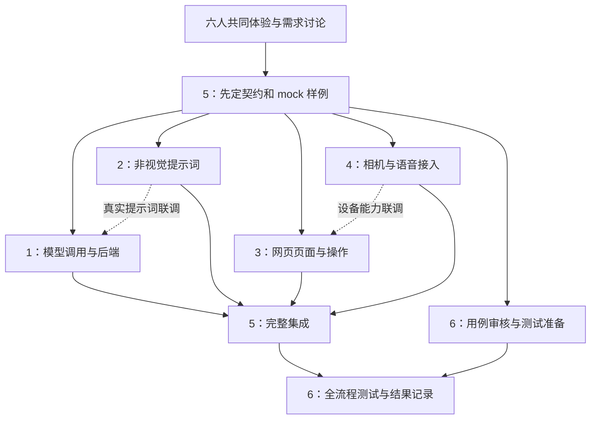

# 六人分工与交接

> 历史说明：本文对应v1阶段，不再作为当前六人编号和工作顺序的依据。当前采用“六人先修改规格，一至两人统一开发”，请先阅读[完整开发规格](DEVELOPMENT_SPEC.md)。保留本文仅便于理解旧代码和历史安排。

共同目标：完成一个可演示、可记录问题的手机网页找物流程。三块工作是模型调用与提示词、网页交互、整合测试。现有视觉大模型直接承担画面判断；提示词重点改善非视觉表达，不额外研发手部识别或抓取算法。

六人先一起熟悉目标任务和已有工具，确认哪些提示在看不见屏幕时仍可理解。成员模拟体验只用于发现流程问题，不直接代表视障人群需求。

## 可直接交给各自 Codex 的共同说明

> 先阅读 `AGENTS.md`、`docs/contract.md` 和自己的任务。只修改自己负责的模块；公共接口由整合负责人统一维护，需要变化时先提交字段、原因及影响。默认 mock 必须明确模拟，live 出错不得伪装成功。密钥只在后端，图片和录音不写入日志或版本库。使用现有 VLM，不扩展成独立检测、跟踪或抓取算法。交付代码、调用示例、已执行检查的真实结果和未验证项；不要只交建议或把计划写成已完成。不得改动历史 `deliverables/`。

## 任务 1：模型调用与最小后端

> 你负责 FastAPI 后端模型调用、转写适配、输入输出校验和明确的错误响应。依据契约实现 `/api/health`、`/api/analyze`、`/api/transcribe`，提供默认 mock。调用任务 2 的提示词模块，替网页保管模型密钥；不要实现页面，也不要在后端复制客户端任务状态机。先用固定模拟响应完成接口，再接真实服务。重点检查缺配置、无效密钥、超时、错误 JSON 和不满足确认条件的输出。

- 依赖：任务 5 的接口契约；任务 2 的提示词可以稍后接入，先使用模块占位。
- 交付：可启动后端、环境变量说明、请求样例、真实执行过的后端测试记录。
- 交给：任务 5 集成，任务 4 调用语音接口，任务 6测试错误路径。
- 边界：任务 2 独立维护提示词内容；任务 1维护供应商适配、校验和响应，不复制提示词。

## 任务 2：非视觉提示词优化

> 你负责 `baseline` 与 `accessible` 两套提示词及版本说明，覆盖 search、calibrate、guide、verify。输入来自契约，输出固定结构；将表达控制为面向本人方向、一次一个可执行动作、可重听且明确不确定。扫描时帮助用户补充画面，核验时区分正确、拿错和看不清。不得用单帧消失或手物重叠直接判断抓取成功。先交设计示例并标记未测，再使用审核后的相同输入比较两套提示词。

- 依赖：任务 5 的字段与枚举。写提示词可并行开始；真实效果比较依赖任务 1 的可用调用和任务 6 的审核样例。
- 交付：提示词模块、版本变化说明、结构化输入输出设计示例、实际失败案例与调整理由。
- 交给：任务 1 加载，任务 6 对照评估；非视觉表达问题与任务 3、4共同确认。
- 边界：不修改 API 凭证、模型供应商调用或页面状态。

## 任务 3：网页页面与操作流程

> 你负责手机优先的 React 页面、任务阶段和操作反馈。根据契约完成目标确认、模式提示、开始、暂停、重听、重新开始和结果反馈；按钮有清楚标签，可键盘及读屏操作。使用任务 4 暴露的设备接口，不在组件里重复写摄像头或录音逻辑。先用 mock 完成不用摄像头的完整演示，再交任务 5 接真实后端。模型确认与使用者实际结果必须分开呈现和记录。

- 依赖：任务 5 的契约、任务 4 的设备接口；真实设备和后端未好时可以用模拟实现。
- 交付：页面、客户端状态流转、错误与暂停反馈、操作说明及已执行的界面检查。
- 交给：任务 5 集成，任务 6 进行手机和无障碍测试。
- 边界：任务 3维护页面及客户端状态；任务 4提供设备能力，任务 5连接模块并修复集成问题，不另写第二份页面。

## 任务 4：相机与语音接入

> 你负责浏览器相机授权、获取新画面、固定相机后的序列采集、录音及 TTS。给任务 3 提供统一的启动、采集、停止、播报与取消接口，并明确权限拒绝和不支持时的返回值。使用任务 1 的语音转写接口，识别文本经用户确认后再开始寻找。页面隐藏或停止时释放媒体和语音；不持久保存图像、音频，也不在设备模块中决定找物阶段。

- 依赖：与任务 3、5先确认设备接口；服务端转写联调依赖任务 1，相机和播报开发可先进行。
- 交付：设备适配模块、错误处理、手机 HTTPS 使用条件、实际浏览器测试记录。
- 交给：任务 3 页面调用，任务 5 集成，任务 6验证权限与中断。
- 边界：采集与播报由任务 4维护；任务状态、界面标签及触发时机由任务 3维护。

## 任务 5：整合与运行交接

> 你先冻结最小契约及模块交接样例，维护共享类型、mock 样例、开发代理和启动说明；之后把任务 1—4 接成可运行 Demo。检查 session/request 对齐、旧帧丢弃、单请求在途、暂停后重新校准，以及 live 失败不转 mock。发现问题交回对应模块负责人修复，避免直接重写他人的模块。向任务 6交付明确版本和可复现启动步骤。

- 依赖：先期契约可独立完成；完整集成依赖任务 1—4。没有真实模型配置时仍可完成 mock 联调。
- 交付：契约与共享类型、可运行集成版本、配置说明、已运行检查及未验证事项清单。
- 交给：全部成员使用契约；最终交任务 6测试，汇总团队提交物。
- 边界：公共契约由任务 5维护；不接管任务 1 的供应商逻辑或任务 3 的页面状态所有权。

## 任务 6：测试与评估

> 你负责审核 `evaluation/cases.csv` 中的设计用例，准备可复现的真实桌面输入和明确答案，填写独立结果记录。区分 mock/live 与 baseline/accessible；先测各模块的异常路径，再测完整 Demo。测试权限拒绝、旧响应、暂停、遮挡、拿错及正确抓取，不把模型自己的确认当真值。没有执行的项目写待测，密钥错误只能证明错误处理是否符合预期，不能作为模型成功。

- 依赖：用例与验收口径可立即准备；后端检查依赖任务 1，提示词比较依赖任务 1、2，设备测试依赖任务 4，全流程依赖任务 5。
- 交付：人工审核后的用例、输入来源与场景说明、按模式分开的测试记录、问题单及课程反思。
- 交给：任务 1—5修复问题；整合负责人汇总实际结果。
- 边界：不改源码以“让测试通过”，不伪造识别、时延、用户评价或视障者验证。

## 依赖图

契约是共同开发前置；实线进入“完整集成”表示交付依赖，不要求等所有人完成后才开始写代码。提示词、设备和页面均可先用设计样例或 mock 并行开发。

## 最小输入／输出交接

| 交接 | 输入 | 输出 |
| --- | --- | --- |
| 5 → 全员 | 任务目标、阶段、方向约定 | `docs/contract.md`、共享类型、mock 示例 |
| 4 → 3／5 | 用户操作、授权、采集或播报请求 | 带采集时间的画面、录音、语音状态、错误、停止能力 |
| 3／5 → 1 | 目标、阶段、帧、参考画面、校准信息、请求 ID | 契约定义的结构化结果或明确 HTTP 错误 |
| 2 → 1／6 | 同一输入和 `prompt_style` | 提示词、版本、待审定表达标准 |
| 1／5 → 3 | `action`、`instruction`、状态和原因 | 页面反馈、可打断播报、下一步操作 |
| 6 → 对应负责人 | 版本、模式、复现步骤、人工真值 | 问题单、未通过项、修复后需复测项目 |

当前代码的公共接口以 `docs/contract.md` 为准。本表用于分工，不应另造一套字段；示例输出和模拟成功都不是实测证据。
